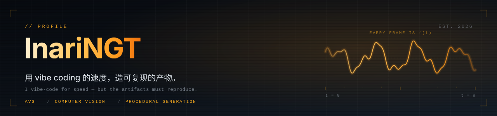

**我关心的问题很具体：同一条链跑第二遍，能不能得到同样的东西。**

写代码可以很快，但「快」不该以「下次跑出别的结果」为代价。所以我做的项目大多在同一个方向上——
把创作过程拆成**确定的编译链**：输入定了，输出就该定，改一版不是重做一遍，而是重跑一次。

*I vibe-code for speed, but I aim at artifacts that reproduce — same input, same output, every time.*

---

## 🔧 编译链：把创作变成可重跑的产物

### [webgal-screenplay-compiler](https://github.com/InariNGT-Ofiicial/webgal-screenplay-compiler)

**把一份文字剧本，编译成一部可玩的 WebGAL 视觉小说。**

`JavaScript` · `MIT` · 零第三方依赖 · 96 项自动化测试

它不做 VN 引擎，它做 VN 引擎的**上游**——补上成熟引擎缺的那一段「剧本 → 原生场景文件」的编译工具链。产物丢进未经一行修改的上游 WebGAL 就能玩，永远不用跟着上游升级打补丁。

### [DS-DFH-1](https://github.com/InariNGT-Ofiicial/DS-DFH-1)

**《东方红一号》代码渲染 MV —— 每一帧都是歌曲时间 `t` 的纯函数。**

`Python` · `MIT` · 1280×720 / 24fps · 琥珀荧光屏 TUI 风格 · 零外部图像素材

没有素材库，没有逐帧手调。给定 `t`，画面就是确定的——这让「改一版」从「重做一遍」变成「重跑一次」。上面那张 banner 的波形，就是这套审美的延伸。

---

## 🎙 语音与内容管线

在 DSH 宿主里跑的一组工具，把「声音」和「内容」也当作可复现的管线来处理。

- **[`dsh-anime-voice`](https://github.com/InariNGT-Ofiicial/dsh-anime-voice)** · `Python` 番剧角色台词提取 → GPT-SoVITS v2 训练配音，含宿主实测记录
- **[`dsh-train-pipeline`](https://github.com/InariNGT-Ofiicial/dsh-train-pipeline)** · `JavaScript` 本地语音数据集、DDSP Reflow 训练、翻唱管线声线注册；Yoshino demo checkpoint 在 Releases
- **[`dsh-cover-pipeline`](https://github.com/InariNGT-Ofiicial/dsh-cover-pipeline)** · `JavaScript` AI 翻唱管线的落地实现，与上面的训练链配套
- **[`dsh-bili-humanism`](https://github.com/InariNGT-Ofiicial/dsh-bili-humanism)** · `JavaScript` · `MIT` B站内容学习：分层取稿 → 证据化理解 → 可修正记忆 → 本地交付。历史/收藏/点赞/投币为人类独立开关，默认全关

授权说明：`dsh-anime-voice` 尚未声明 license，两个 pipeline 仓库标记为 `NOASSERTION`。想复用请先开 issue 问一句。

---

## 🧰 技术栈

`Python` · `JavaScript / Node.js` · `Pillow` · 计算机视觉与标注 · 程序化生成 · 编译链与 DSL 设计

---

## 📌 现在在做

把同一套「编译链」思路往更多创作场景上推：剧本、影像、音频、视觉标注。

凡是**「输入确定就该输出确定」**的地方，我都有兴趣把它做成可复现的。

---

## 📫 联系

对哪个项目有想法、或者发现 bug，欢迎直接到对应的仓库开 issue。

也可以在 [B站](https://space.bilibili.com/109431227) 找到我。
